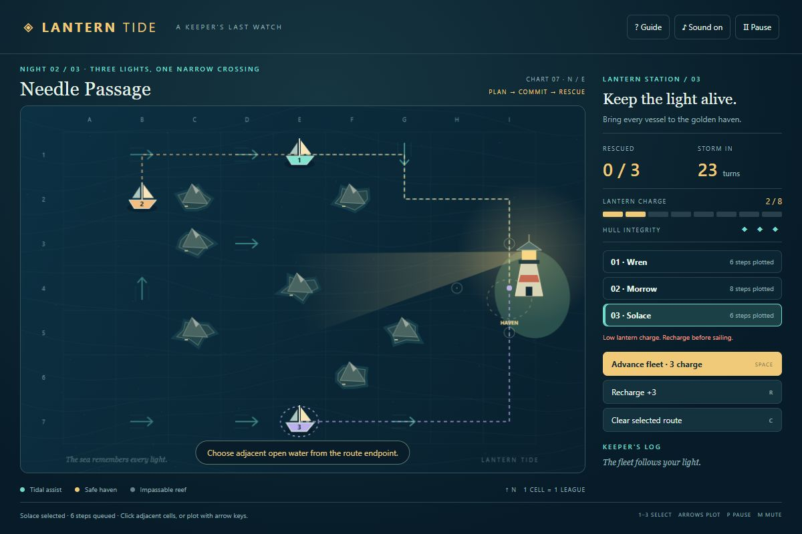

# Lantern Tide

One light. Three nights. Bring every vessel home.

Lantern Tide is an original, turn-based lighthouse rescue puzzle for desktop browsers. Plot routes through a hand-drawn procedural archipelago, borrow the tide to save lantern charge, and coordinate your fleet before the storm closes the passage. Every decision is yours: there is no real-time timer and nothing moves until you commit a turn.

## Play

Serve `game/` with any static server, then open `index.html` in a current desktop browser. For example, from the repository:

    python -m http.server 8080 --directory game

Open http://localhost:8080. No build, dependencies, accounts, internet access, fonts or downloaded media are required. ES modules are loaded as local static files; use a static server rather than a file:// URL.

## The keeper's rules

- Select Wren, Morrow or Solace with a mouse click or keys 1–3.
- Click adjacent water cells, or use arrow keys, to queue a route. Rings mark legal continuations.
- Turquoise arrows carry a ship one extra cell free. Continue your route from the landing cell.
- Space or Advance Fleet moves every routed ship one step. Each ship spends one charge; the storm advances one turn. Unrouted ships hold position.
- R or Recharge restores three charge up to eight. The fleet holds, but the storm still advances one turn.
- Two vessels ending on the same water cell cost one hull point. The gold haven can receive several ships safely. The fleet forecast warns about collisions and insufficient charge.
- C clears the selected route. P pauses; M toggles synthesized audio. The Guide is available in play.
- Rescue every vessel before the storm countdown reaches zero, with hull remaining. Finish all three nights to win the watch. Retry a night or restart the entire watch from the results screen.

Scoring: 100 per rescued ship, 10 per unused storm turn on a completed night, and 25 per remaining hull point. Three different charts introduce more vessels, narrow passages and converging currents.

## Original source

- `game/model.mjs`: deterministic fleet, route, collision, forecast, energy and storm rules.
- `game/render.mjs`: procedural canvas sea, islands, ships, lighthouse, beam and tidal chart.
- `game/app.mjs`: accessible DOM controls, keyboard/mouse input, tutorial, campaign and results.
- `game/audio.mjs`: original Web Audio oscillator motifs, with mute and silent fallback.
- `game/style.css`: responsive navy, teal and gold interface.
- `main.ts`: Node 22.18+ standard-library exporter.
- `vendor/makefun-game.ts`: unchanged official kit dossier library; not game code.

All game art and sound are generated locally by this game's own source. No external assets or game engine are used. The four JPEGs in `screenshots/` are native 1200×800 browser captures of the title, live play and actual campaign victory, without compositing or image editing.

## Reproduce the artifact

    MAKEFUN_OUTPUT_DIR=/absolute/path/to/new-output node main.ts

Run on Node 22.18 or later. It exports `game/`, `screenshots/` and `dossier.json`; the dossier uses the official starter's caps. The exporter needs no network and installs nothing.

The recorded build used real Node model tests and isolated Playwright/Chromium input replay. Its browser tests completed all three nights while the browser network was offline, exercised defeat, restart, tutorial, pause and mute, and tracked requests plus console/page errors. Test scripts and native session evidence are retained outside this repository for the bounty handoff. Local tests are not a make.fun server score.

Built for [make.fun best-game-01](https://make.fun/bounty/best-game-01). Publishing this repository does not submit an entry. MIT licensed; see LICENSE.
